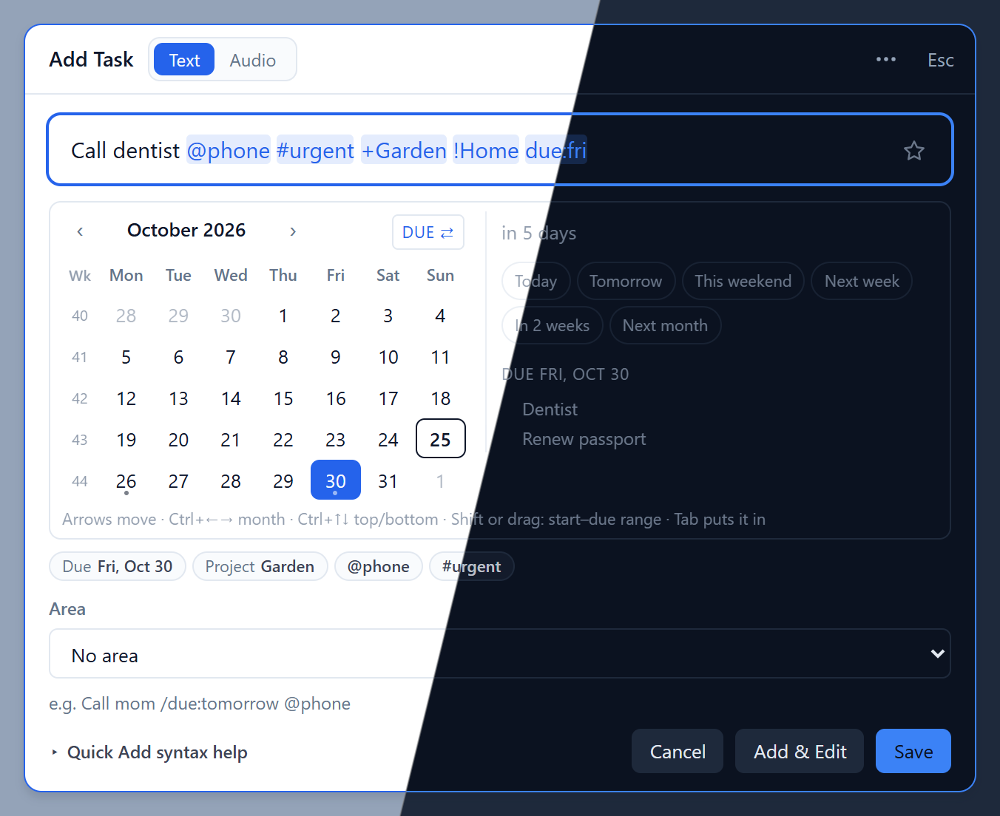
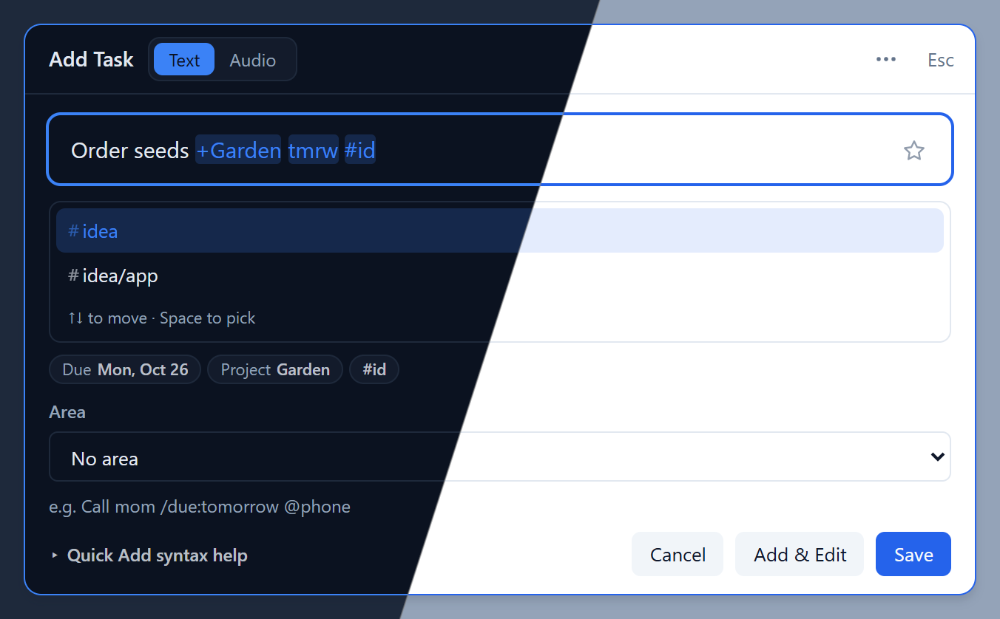
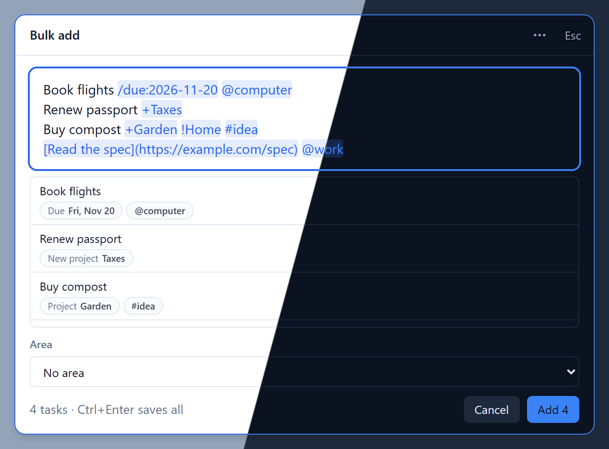
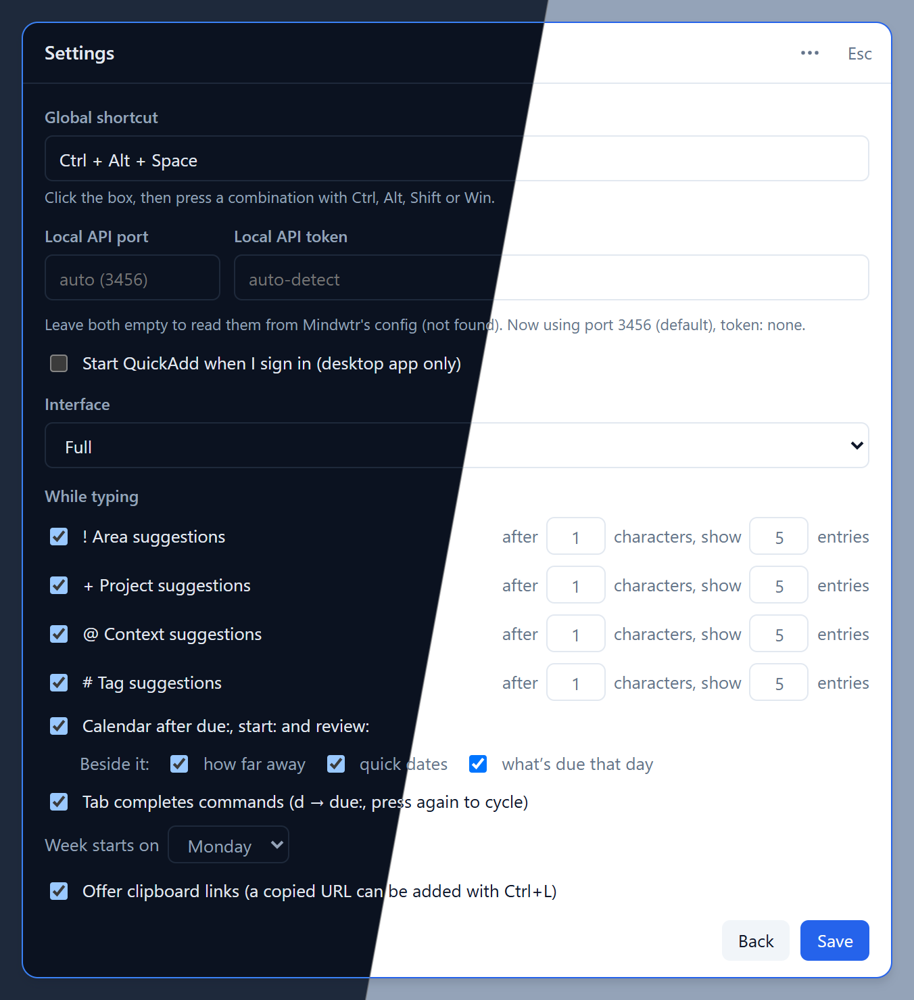

# Mindwtr QuickAdd

A small always-on-top quick-capture window for [Mindwtr](https://github.com/dongdongbh/Mindwtr)
on Windows. Press a global shortcut, type a task in Mindwtr's Quick Add syntax, press Enter,
and the task lands in your running Mindwtr desktop app through Mindwtr's **Local API**.

An unofficial companion, not affiliated with the Mindwtr project. AGPL-3.0, like Mindwtr: `vendor/`
holds Mindwtr's own `packages/core` (and reference copies of its quick-add components) at v1.3.6, so
input is parsed exactly as Mindwtr parses it. See `SPEC.md` for the original design contract.

## Screenshots

Each shot is split diagonally between light and dark; QuickAdd follows the Windows theme.

**Capture with the calendar**: highlighted tokens, parsed-field chips, and the date side panel (distance, quick picks, what is already due).



**Suggestions** for `+Project`, `@context` and `#tag`, plus `tmrw` parsed as a due date.



**Bulk add**: one task per line, each parsed and previewed before saving.



**Settings**: shortcut, Local API override, interface mode, suggestion thresholds, calendar panel parts, tab completion, week start, clipboard links.



## 1. Turn on Mindwtr's Local API

QuickAdd talks to Mindwtr over `http://127.0.0.1:<port>` with a bearer token. This is off by default.

1. Open Mindwtr → **Settings → Advanced**.
2. Turn on **Enable local API server**. Leave the port at 3456 unless it clashes with something.
3. Keep Mindwtr running (it can be minimised). QuickAdd shows a red notice if it can't reach it.

QuickAdd reads the port and token itself, so there is nothing to copy:

| Value | Where Mindwtr stores it |
|---|---|
| `local_api_enabled`, `local_api_port` | `config.toml` |
| `local_api_token` | `secrets.toml` (older configs: `config.toml`) |

in `%LOCALAPPDATA%\Packages\DongdaLi.Mindwtr_*\LocalCache\Roaming\mindwtr\config\` (Microsoft
Store build), falling back to `%APPDATA%\mindwtr\config\`. The files are re-read on every request,
so enabling the API or changing the token in Mindwtr works without restarting QuickAdd. Port and
token can also be overridden in QuickAdd's Settings.

## 2. Use it

- **Ctrl+Alt+Space** (changeable in Settings) shows or hides the window. It also sits in the tray.
- **Enter** saves, **Esc** hides. The ☆ star adds the task to today's focus; the Area select sets a
  default area for tasks that don't name a project.
- **Enter** saves, **Ctrl+Enter** (or **Add & Edit**) saves and opens the task in Mindwtr's editor
  via its `mindwtr://open?task=` link.
- Tokens you type are tinted as they are recognised, with a preview of what was parsed below the input.
  All of Mindwtr's syntax works (`/due:`, `@context`, `#tag`, `+Project`, `!Area`, `%Person`, …), plus
  `!1`–`!4` for priority, `start:`/`due:`/`review:` without the slash, `td`/`tmrw` for today/tomorrow,
  and `[label](https://…)` links. A `+Project` that doesn't exist yet is created in Mindwtr.
- **Suggestions**: after `!`, `+`, `@` or `#` a list of your areas, projects, contexts or tags opens;
  ↑↓ move, Tab/Space/Enter pick, Esc closes. When it opens and how many entries it shows are settings.
- **Tab completes commands**, shell style: `d` → `/duration:` → `due:` (Tab again picks today).
- **Calendar** after `due:`, `start:` or `review:` (or while typing a value like `due:fri`): arrows
  move, Ctrl+arrows jump by month or to the top/bottom of the month, Shift+arrows or a mouse drag pick
  a start–due range, Tab/Space pick. A side panel shows how far away the date is, one-click dates,
  and what is already due that day (each part can be turned off).
- **↑ in an empty field** recalls earlier entries; **Ctrl+L** adds a copied URL as a link.
- **Interface**: Full, Reduced (no example line) or Minimal (just the input) in Settings.
- **… menu**: Import .txt (loads a file into Bulk add), Bulk add (one task per line, Ctrl+Enter saves
  all; Esc goes back to a single task), Settings, Quit.
- **Audio**: records a voice note and creates "Audio note <date time>" (or the text you typed) with the
  recording attached as a file. Recordings are kept in `%APPDATA%\Mindwtr QuickAdd\recordings\`.
  There is no speech-to-text.

## 3. Develop

Requires Node ≥ 22.18 and npm.

```sh
npm install
npm run dev        # Electron + Vite dev server
npm run dev:web    # renderer only, in a normal browser at http://localhost:5173 (mock data;
                   # add ?mockError=unreachable to see the "API off" state)
npm run typecheck
npm test           # unit tests (vitest)
npm run build      # out/main, out/preload, out/renderer
npm run dist       # Windows installer in release/ (NSIS, unsigned)
```

Electron's binary is downloaded on first run (npm 11 skips install scripts); if that fails, run
`node node_modules/electron/install.js`.

### Testing without Mindwtr

`scripts/mock-local-api.mjs` imitates the Local API routes QuickAdd uses (bearer auth, in-memory
areas/projects/tasks, logs every POST body):

```sh
npm run mock-api                                   # 127.0.0.1:3457, token dev-token
# in another terminal (bash):
QUICKADD_API_PORT=3457 QUICKADD_API_TOKEN=dev-token npm run dev
```

`QUICKADD_API_PORT` / `QUICKADD_API_TOKEN` override detection and Settings. `QUICKADD_USER_DATA`
points the app at a separate profile folder, `QUICKADD_KEEP_ON_BLUR=1` stops it hiding on blur, and
`QUICKADD_SELFTEST=1` runs a scripted smoke test (bridge calls plus typing into the real UI), prints
the results and quits:

```sh
npm run build
QUICKADD_SELFTEST=1 QUICKADD_API_PORT=3457 QUICKADD_API_TOKEN=dev-token npx electron .
```

## Layout

```
src/main/       Electron main: window, tray, hotkey, settings, Local API config + client
src/preload/    contextBridge (window.quickAdd) and the shared bridge types
src/renderer/   React UI (plain CSS); mock-bridge.ts stands in for preload in a browser
src/parser/     capture parser wrapping Mindwtr core's parseQuickAdd
vendor/         Mindwtr core and desktop reference sources @ v1.3.6 (read-only)
scripts/        build, dev, icon and mock-API scripts
```
